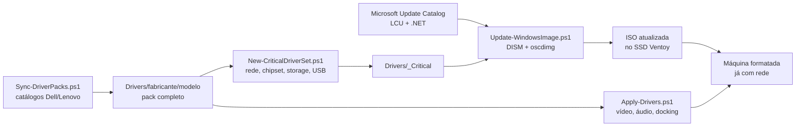

# windows-imaging-toolkit

Toolkit PowerShell que transforma um SSD USB com [Ventoy](https://www.ventoy.net) em
um drive de formatação **que já instala o Windows 11 atualizado e com driver de
rede**. Baixa os driver packs oficiais da Dell e da Lenovo, filtra só o que precisa
estar dentro da imagem, aplica o cumulative update mais recente do Microsoft Update
Catalog no `install.wim` e remonta a ISO.

> **Resultado medido:** ISO de **9,29 GB** com Windows 11 Pro 24H2 na build
> **26100.9168** (cumulative de ago/2026 + .NET 4.8.1) e **241 MB de drivers
> críticos** embutidos, gerada em ~1h15 quase sem supervisão. Download de driver
> pack da Dell foi de **182 KB/s para 11,9 MB/s** com 6 conexões paralelas.

---

## Problema

O drive de formatação tinha só uma ISO original do Windows 11 de julho/2025 e
nenhuma automação. Duas consequências práticas a cada máquina formatada:

1. **Windows Update pós-instalação demorava horas** — a imagem carregava mais de um
   ano de cumulative updates para baixar depois de instalada.
2. **A máquina nascia sem driver de rede** — sem Ethernet/Wi-Fi não dava nem para
   baixar o resto; era preciso caçar driver em outro computador. O OOBE do Windows 11
   ainda exige internet, então a instalação travava ali.

## Solução

Atacar as duas dores **na origem**: injetar os updates e os drivers críticos dentro
da imagem, antes de instalar.



| Script | O que faz | Admin |
|---|---|---|
| `Sync-DriverPacks.ps1` | Consulta o `DriverPackCatalog` da Dell e o `catalogv2` da Lenovo, resolve o pack mais recente por modelo, baixa com verificação de hash e extrai | não |
| `New-CriticalDriverSet.ps1` | Lê a classe de cada `.inf` e copia só Net, System, HDC, SCSIAdapter e USB para `_Critical` | não |
| `Update-WindowsImage.ps1` | Extrai a ISO, baixa LCU e .NET do Microsoft Update Catalog, aplica no `install.wim`, injeta drivers no `install.wim` e no `boot.wim`, roda `/ResetBase` e remonta a ISO com `oscdimg` | **sim** |
| `Apply-Drivers.ps1` | Na máquina recém-instalada, detecta o modelo e instala o pack completo com `pnputil`, comparando dispositivos sem driver antes/depois | **sim** |
| `lib/FastDownload.ps1` | Download em faixas HTTP Range paralelas com `RunspacePool` (PowerShell 5.1 e 7), retentativa por faixa e fallback para fluxo único | — |
| `lib/MsCatalog.ps1` | Consulta o Microsoft Update Catalog (que não tem API pública) e extrai as URLs reais dos `.msu` | — |

---

## Como usar

### Pré-requisitos

| Item | Observação |
|---|---|
| Windows 10/11 com PowerShell 5.1 ou 7 | Os scripts funcionam nos dois |
| Administrador local | Só para `Update-WindowsImage.ps1` e `Apply-Drivers.ps1` (DISM e `pnputil`) |
| `oscdimg.exe` (Windows ADK) | Não distribuído aqui — ver [`bin/README.md`](bin/README.md) |
| ~40 GB livres em volume **NTFS** | Área de trabalho do DISM (`C:\VentoyBuild` por padrão, só Administradores e SYSTEM) |
| ISO oficial do Windows 11 com `install.wim` | ISOs com `install.esd` são recusadas (somente leitura) |

### Layout esperado no SSD

Os scripts descobrem tudo a partir da própria pasta: copie o conteúdo deste
repositório para `<SSD>\_toolkit` e o `ventoy.json` de exemplo para `<SSD>\ventoy\`.

```
<SSD>\
├── ISO\                       imagens de boot (o Ventoy varre recursivamente)
├── Drivers\
│   ├── Dell\<Modelo>\         driver pack completo, extraído
│   ├── Lenovo\<Modelo>\
│   ├── _Critical\             só rede/chipset/storage — é o que entra na imagem
│   └── _stage\                temporário de download
├── ventoy\ventoy.json         menu, aliases e bypasses do Ventoy
└── _toolkit\                  ← este repositório
    ├── Sync-DriverPacks.ps1
    ├── New-CriticalDriverSet.ps1
    ├── Update-WindowsImage.ps1
    ├── Apply-Drivers.ps1
    ├── models.json            parque de máquinas coberto
    ├── bin\oscdimg.exe        (você coloca)
    └── lib\
```

### Rotina trimestral

```powershell
cd D:\_toolkit

# 1. Atualiza os driver packs de todo o parque cadastrado em models.json
.\Sync-DriverPacks.ps1 -FromManifest -RefreshCatalog

# 2. Refaz o conjunto crítico a partir dos packs
.\New-CriticalDriverSet.ps1 -Limpar

# 3. Gera a ISO nova  << POWERSHELL COMO ADMINISTRADOR >>
.\Update-WindowsImage.ps1            # saída: ISO\WIN11_UPD_<versão>_<AAAAMM>.iso
```

Depois aponte `VTOY_DEFAULT_IMAGE` e `menu_alias` no `ventoy.json` para a ISO nova.
Se algo falhar no meio, rode de novo com `-ReuseScratch` para reaproveitar a ISO
extraída e os `.msu` já baixados.

### Modelo novo / máquina recém-formatada

```powershell
# Na própria máquina: detecta fabricante/modelo e baixa o pack certo
D:\_toolkit\Sync-DriverPacks.ps1 -Auto

# Depois de instalar o Windows (como administrador)
D:\_toolkit\Apply-Drivers.ps1                 # instala
D:\_toolkit\Apply-Drivers.ps1 -RelatorioSomente  # só diagnostica
```

O passo a passo operacional completo está em [`docs/USO.md`](docs/USO.md).

---

## Resultados medidos

### Imagem gerada (execução de 05/09/2026)

| Item | Valor |
|---|---|
| ISO final | **9,29 GB**, Windows 11 Pro 24H2 |
| Build | **26100.9168** (KB5121003, cumulative de ago/2026) |
| .NET | KB5122385 (.NET Framework 3.5 e 4.8.1) |
| Drivers embutidos | **241 MB**, 133 INF, no `install.wim` **e** no `boot.wim` |
| Origem | ISO original de jul/2025 (5,18 GB) |

### Tempo por etapa

| Etapa | Duração |
|---|---|
| Extrair a ISO de origem | ~30 s |
| Baixar LCU + checkpoint + .NET (5,4 GB) | ~2 min |
| Montar o `install.wim` | ~3 min |
| **Aplicar o cumulative update** | **~28 min** |
| Injetar drivers | ~2 min |
| `/ResetBase` | ~5 min |
| **Commit do `install.wim`** | **~26 min** |
| `boot.wim` (drivers + commit) | ~5 min |
| Remontar com `oscdimg` | ~33 s |

Os dois blocos longos são inerentes ao DISM. Total: ~1h15, quase todo sem supervisão.

### Download paralelo

| Origem | 1 conexão | 6 faixas paralelas |
|---|---|---|
| `downloads.dell.com` | 182 KB/s | **11.904 KB/s** (~65×) |
| `download.microsoft.com` | 7.357 KB/s | — |
| Microsoft Update Catalog — LCU de 4.867 MB | — | 43,2 MB/s (1min52) |
| Microsoft Update Catalog — checkpoint de 509 MB | — | 22,7 MB/s |
| Microsoft Update Catalog — .NET de 92 MB | — | 20,1 MB/s |

A Dell (ou o proxy no caminho) limita **por conexão**, não por banda: em fluxo único
o pack de 3,4 GB levaria mais de 5 horas.

---

## Decisões e armadilhas (o que custou tempo e ficou no código)

- **Checkpoint "Superseded" não é erro.** A partir do 24H2 o catálogo entrega o LCU
  junto com um *checkpoint update*. Os pacotes são aplicados em laço com retentativa
  (a ordem se resolve sozinha), e o que sobra sem progresso é registrado como
  "dispensado". A primeira versão tratava isso como falha fatal e descartou 40
  minutos de servicing que tinham dado certo.
- **DISM não monta imagem em exFAT.** Ele grava ACLs do NTFS ao montar um WIM; o
  script valida o sistema de arquivos da área de trabalho e aborta se não for NTFS.
- **Extratores Dell/Lenovo falham em silêncio com espaço no caminho** (exit code 10,
  zero arquivos). A extração vai para uma pasta temporária sem espaço em disco local
  e só depois é copiada com `robocopy`, conferindo a contagem de `.inf` no destino.
- **Teto de tamanho no conjunto crítico.** Pacotes de vídeo/áudio trazem INF
  auxiliar com `Class=System`; sem o teto (`-MaxDriverMB 150`) o conjunto "crítico"
  passou de 9,8 GB. Com o teto ficou em 241 MB.
- **Aspas do `oscdimg -bootdata`.** Passar como array faz o PowerShell reescrever as
  aspas internas; a linha de comando é montada inteira como string e repassada
  intacta ao `CreateProcess`.
- **`robocopy` retorna 1 em sucesso.** O código é normalizado para o script não
  terminar reportando falha.
- **Área de trabalho só de administradores.** Na raiz do `C:\` qualquer usuário cria
  pasta e ganha *Modificar* nela por herança, então dava para plantar arquivo na ISO
  extraída ou nos `.msu` que o DISM injeta como administrador. A pasta agora nasce com
  ACL sem herança (Administradores e SYSTEM, por SID, porque o Windows pode estar em
  pt-BR). Se ela já existir com outro dono ou outra ACL, o script recusa em vez de corrigir.
- **`.msu` conferido pelo SHA1 do próprio nome.** O Catalog publica
  `<nome>_<sha1>.msu`, e o sufixo é o SHA1 do conteúdo. Tanto o download novo quanto o
  `.msu` reaproveitado de uma tentativa anterior só entram se o hash bater. Nome sem o
  sufixo é recusado, e `http://` vira `https://`.
- **A ISO gerada não vira origem.** Ela casa no mesmo padrão que `Find-SourceIso`
  procura e é sempre a mais recente. As ISOs com o prefixo de saída (`-IsoPrefix`)
  agora ficam de fora.

---

## Pendências conhecidas

- Cobertura de fabricantes: só Dell e Lenovo.

## Licença

[MIT](LICENSE) © Jonatas Alves. Windows, DISM e `oscdimg` são da Microsoft; os
driver packs são baixados direto dos sites oficiais da Dell e da Lenovo e não são
redistribuídos aqui.
